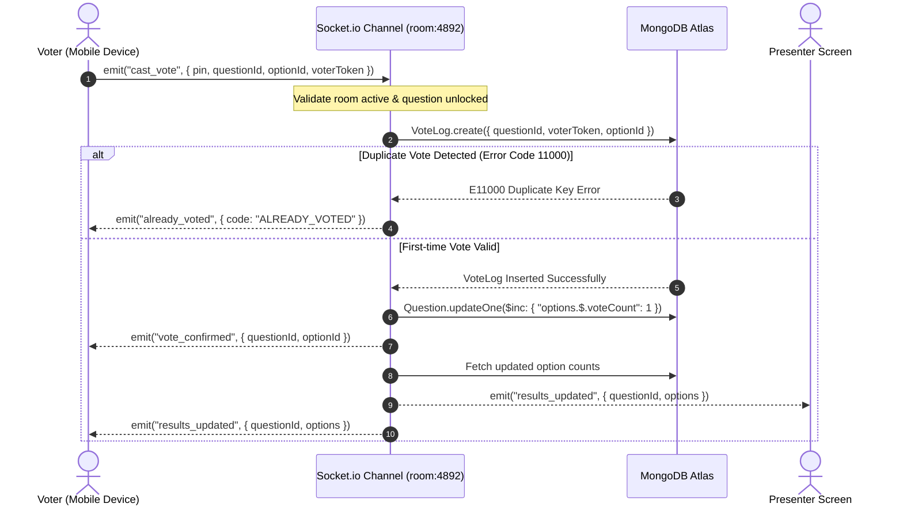

# QuickPoll Live

> **An unauthenticated, real-time audience polling engine built on the MERN stack with Socket.io.** Designed for seamless classroom interaction, live conferences, and seminars — zero voter registration required.

---

## 📌 Problem Statement

Traditional audience response systems (Mentimeter, Kahoot, Slido, Google Forms) introduce significant friction into fast-paced educational and presentation environments:
- **High Onboarding Barrier:** Forcing audience members to download native apps, register accounts, or authenticate with email slows participation and reduces engagement rates.
- **Race Conditions & Double Voting:** Basic web polls often rely on easily bypassed browser cookies or client-side checks, leaving them vulnerable to spam and concurrent voting anomalies.
- **Polling Latency:** Traditional HTTP short-polling architectures fail to deliver immediate, synchronized visual feedback to hundreds of simultaneous participants, creating lag between the vote and the visual bar update.
- **Database Bloat:** Ephemeral polling sessions accumulate indefinitely in databases without automated retention policies or lifecycle management.

---

## 🎯 Target Users

1. **Educators & University Professors:** Conduct pop quizzes, check lecture comprehension, and gauge student sentiment in real time without wasting lecture time on onboarding.
2. **Conference Speakers & Workshop Hosts:** Engage large convention halls instantly with live surveys and interactive Q&A checkpoints or take feedbacks comfortably after the session.
3. **Students & Audience Attendees:** Participate anonymously and instantly from any smartphone or laptop camera with a 1-second QR scan or 4-digit PIN.

---

## 💡 Solution

QuickPoll Live eliminates all participant onboarding barriers while maintaining enterprise-grade concurrency and idempotency guarantees:
- **Zero-Barrier Voter Access:** Voters join via an auto-focus 4-digit numeric PIN (`4892`) or a dynamic QR code (`/join?pin=4892`). No username, email, or password required.
- **Sub-50ms Real-Time Distribution:** Built on WebSocket room channels (`room:${pin}`) using Socket.io for immediate bi-directional state synchronization.
- **Cryptographic & Database Deduplication:** Client-generated opaque UUID fingerprints stored in `localStorage` paired with a compound unique index on MongoDB guarantee exactly-one-vote semantics at the database engine layer.
- **Atomic Concurrency:** Vote counters increment via atomic `$inc` operations, eliminating race conditions under mass concurrent voting.
- **Automated 24-Hour Ephemeral Lifecycles:** MongoDB TTL (`expireAfterSeconds`) indexes automatically purge rooms and vote logs after 24 hours, ensuring zero database maintenance overhead.

---

## ✨ Key Features

### For Presenters
- **Secure Presenter Authentication:** JWT-based presenter accounts with bcrypt-hashed credentials and 7-day persistent session management.
- **Intuitive Poll Creation:** Fast room generator with automatic collision-free 4-digit PIN assignment and multi-option question builder.
- **Projector-Ready Live View (`/presenter/:pin`):**
  - High-contrast, dark-mode presenter HUD optimized for lecture hall projection.
  - On-screen dynamic SVG QR code encoding the exact session link.
  - Real-time animated vote distribution bars with option letters (A, B, C, D), percentage displays, raw counters, and leading winner badges (👑).
  - Live connected headcount and total vote telemetry.
- **Live Session Controls & Enhancements:**
  - **Synchronized Live Countdown Timer:** Select 15s, 30s, or 60s countdowns with animated progress bar synchronized in real-time across voter devices. Automatically locks submissions on expiration.
  - **Lock / Unlock Voting:** Freeze submissions instantly with visual indicator status broadcasts.
  - **Show / Hide Correct Answer:** Reveal the correct answer to the audience on demand.
  - **Step-Through Navigation:** Advance questions cleanly with automatic voter UI resets.
  - **One-Click PDF Analytics Export:** Generate and download branded, styled PDF analytical reports containing session metadata, response metrics, and question-by-question breakdowns.
  - **Session Lifecycle & Room Management:** Close/end active sessions, reopen them on demand, or permanently delete rooms from the dashboard with cascading cleanup.
- **Export Formats:** Export poll analytics as PDF, CSV (`/api/rooms/:pin/export?format=csv`), or raw JSON.

### For Voters (Audience)
- **Frictionless Entry:** Clean PIN input screen (`/join`) with automatic query parameter parsing (`?pin=4892`).
- **Touch-Optimized Voting Interface:** Large touch targets (A, B, C, D) designed specifically for mobile ergonomics.
- **Instant Optimistic Feedback:** Selected options highlight immediately upon touch with micro-animations.
- **Smart State Transitions:**
  - Automatic transition to "Vote Recorded! Waiting for presenter..." state.
  - Live alert banner when presenter freezes voting.
  - Seamless screen reset to active state as soon as the presenter advances questions.
- **Device-Level Idempotency:** Browser fingerprinting prevents double voting even if the attendee refreshes or closes and reopens the tab.

---

## 🚀 60-Second Evaluation Walkthrough for Reviewers

Follow these steps to evaluate the real-time polling engine using two browser tabs:

### Prerequisites
1. Ensure your MongoDB Atlas connection string is configured in `server/.env`.
2. Run `npm run seed` to populate the demo environment.
3. Start the application servers.

---

### Step-by-Step Dual-Tab Walkthrough

| Step | Window / Tab | Action | Expected Result |
|:---:|:---|:---|:---|
| **1** | **Tab 1 (Presenter)** | Open `http://localhost:5173/login` | Login page loads with demo credentials displayed. |
| **2** | **Tab 1 (Presenter)** | Click **Sign In to Dashboard** using `teacher@college.edu` / `password123` | Redirects to Dashboard showing rooms and analytics. |
| **3** | **Tab 1 (Presenter)** | Click **Open** on the room **"System Design & Distributed Systems Pop Quiz" (PIN: 4892)** | Presenter live display loads with QR code and Question #1. |
| **4** | **Tab 2 (Voter)** | Open `http://localhost:5173/join?pin=4892` (simulating an audience phone) | Automatically joins Room 4892 and displays Question #1 with 4 options. |
| **5** | **Tab 2 (Voter)** | Tap option **A: "2dsphere Index"** | Button highlights immediately and transitions to "Vote Recorded!". |
| **6** | **Tab 1 (Presenter)** | Observe Presenter Screen | **Result bar for option A smoothly animates to 100% (1 vote) in real time.** |
| **7** | **Tab 2 (Voter)** | Refresh the page or tap another option | Vote remains locked; deduplication stops duplicate voting. |
| **8** | **Tab 1 (Presenter)** | Click **Lock Voting** (Red/Green button) | Presenter button changes to "Locked". |
| **9** | **Tab 2 (Voter)** | Look at Voter screen | Amber alert appears: *"Voting is currently locked by the presenter."* |
| **10** | **Tab 1 (Presenter)** | Click **Next Question** | Advances to Question #2 ("Which protocol fits bi-directional streaming?"). |
| **11** | **Tab 2 (Voter)** | Look at Voter screen | View resets cleanly to Question #2 with all option buttons active. |
| **12** | **Tab 1 (Presenter)** | Click **Show Answer** | Correct option is highlighted with a green checkmark badge. |
| **13** | **Tab 1 (Presenter)** | Click **End Poll & Return** | Safely exits the session back to the Presenter Dashboard. |

---

## 🔑 Demo & Seed Credentials

The database is pre-seeded with clean demo data:

| Key | Value |
|---|---|
| **Presenter Email** | `teacher@college.edu` |
| **Presenter Password** | `password123` |
| **Demo Room PIN** | `4892` |
| **Demo Room Title** | System Design & Distributed Systems Pop Quiz |
| **Seeded Questions** | 3 technical distributed systems questions |

Reset to this clean state at any time by running:
```bash
npm run seed
```

---

## 🧰 Tech Stack

| Layer | Technology | Purpose |
|---|---|---|
| **Runtime** | Node.js (v22 LTS) | High-performance asynchronous backend execution |
| **Backend Framework** | Express.js (v4) | RESTful API routing, middleware pipeline, static serving |
| **Real-Time Engine** | Socket.io (v4) | Low-latency WebSockets with automatic fallback |
| **Database** | MongoDB Atlas | Cloud NoSQL database with atomic operators & TTL |
| **ODM Layer** | Mongoose (v8) | Schemas, validations, pre-save hooks, and indexes |
| **Authentication** | JWT & bcryptjs | Stateless authorization and salted credential hashing |
| **Frontend Framework**| React (v18) + Vite (v6) | Component-driven UI with lightning-fast HMR and bundling |
| **Routing** | React Router DOM (v6) | Client-side routing, route guards, query-param parsing |
| **Styling** | Tailwind CSS (v3) | Projector-ready dark-mode design system & animations |
| **Icons & Visuals** | Lucide React | Clean, consistent SVG iconography |
| **QR Engine** | qrcode.react | Dynamic client-side SVG QR code generation |
| **HTTP Client** | Axios | Configured API client with automatic JWT bearer injection |

---

## 🏗 Architecture & System Design

### 1. High-Level System Architecture

```
[ Audience Mobile / Web ]         [ Presenter Dashboard ]
         │                                   │
         │  HTTP / REST (JWT Auth)           │  HTTP / REST (JWT Auth)
         ├───────────────────────────────────┼───────────────────┐
         │                                   │                   │
         │  WebSocket Events (Cast Vote)     │  WebSocket Events (State Controls)
         ▼                                   ▼                   │
   ┌───────────────────────────────────────────────┐             │
   │            Express + Socket.io Server         │             │
   │  ───────────────────────────────────────────  │             │
   │  • JWT Auth Middleware (protect)              │             │
   │  • Room Channel Gateway: io.to("room:${pin}") │             │
   │  • REST API Controllers (/api/auth, /rooms)   │             │
   │  • Static Client File Server (client/dist)    │             │
   └───────────────────────┬───────────────────────┘             │
                           │                                     │
                           │ Mongoose Driver (Atomic Ops)        │
                           ▼                                     ▼
   ┌─────────────────────────────────────────────────────────────┐
   │                       MongoDB Atlas                         │
   │  ─────────────────────────────────────────────────────────  │
   │  • users: Presenter credentials (bcrypt)                    │
   │  • rooms: Session state + PIN (TTL: 24h)                    │
   │  • questions: Questions & options array with voteCount      │
   │  • votelogs: Compound unique { questionId, voterToken }     │
   └─────────────────────────────────────────────────────────────┘
```

### 2. High-Concurrency Voting Flow (Idempotency Engine)



### 3. Data Hygiene via MongoDB TTL Indexes
Both ephemeral collections utilize native background time-to-live indexes:
- **`Room.createdAt`** &rarr; `expires: 86400` (24 hours).
- **`VoteLog.createdAt`** &rarr; `expires: 86400` (24 hours).

No manual cron jobs or deletion routines are required; expired documents are automatically swept by MongoDB's background thread.

---

## 💻 Local Setup Instructions

### Prerequisites
- [Node.js](https://nodejs.org/) v18.0.0 or higher
- [Git](https://git-scm.com/)
- A free [MongoDB Atlas](https://www.mongodb.com/cloud/atlas) cluster (or local MongoDB on port 27017)

### 1. Clone the Repository
```bash
git clone https://github.com/<your-username>/quickpoll-live.git
cd quickpoll-live
```

### 2. Install Dependencies
Install dependencies across both backend and frontend workspaces from the project root:
```bash
npm run install:all
```
*(Or install individually: `npm install --prefix server && npm install --prefix client`)*

### 3. Configure Environment Variables
Create your backend `.env` file from the example template:
```bash
cp server/.env.example server/.env
```
Open `server/.env` and update `MONGO_URI` with your connection string (see [Environment Variables](#-environment-variables)).

### 4. Seed the Database
Populate the database with the verified demo presenter, room, and questions:
```bash
npm run seed
```

### 5. Start Development Servers
Run each service in a separate terminal:

**Terminal 1 — Backend API & Socket Engine:**
```bash
cd server
npm run dev
```
*Server starts on `http://localhost:5000`.*

**Terminal 2 — Frontend Application:**
```bash
cd client
npm run dev
```
*Vite dev server starts on `http://localhost:5173`.*

Open your browser at **`http://localhost:5173`**.

---

## 🔐 Environment Variables

The server requires the following configuration in [`server/.env`](file:///c:/Users/hp/OneDrive/Desktop/Extras/Mern/End%20term%20Project/Quick%20Poll%20Live/server/.env). A template is provided in [`server/.env.example`](file:///c:/Users/hp/OneDrive/Desktop/Extras/Mern/End%20term%20Project/Quick%20Poll%20Live/server/.env.example).

| Variable | Description | Example / Default |
|---|---|---|
| `PORT` | Port number for the Express and Socket.io server | `5000` |
| `NODE_ENV` | Application runtime environment (`development` or `production`) | `development` |
| `MONGO_URI` | MongoDB Atlas or local connection string | `mongodb+srv://<username>:<password>@cluster0.xxxxx.mongodb.net/quickpoll_live?retryWrites=true&w=majority` |
| `JWT_SECRET` | Secret cryptographic key used to sign presenter JWT tokens | `supersecretjwtkey_quickpoll_live_2026_dev_key` |
| `CLIENT_URL` | Frontend origin for CORS policy validation | `http://localhost:5173` |

> ⚠️ **Security Note:** Never commit your actual `.env` file or database credentials to version control. `server/.env` is ignored in `.gitignore`.

---

## 🌐 Deployment Instructions (Render)

QuickPoll Live is architected as a **single unified production deployment**. When built, the Express backend serves the pre-compiled Vite frontend bundle (`client/dist`), eliminating all CORS and multi-port proxy complications.

### Deploying to Render (Free Web Service)

1. **Push your code to a GitHub repository.**
2. Go to the [Render Dashboard](https://dashboard.render.com/) and click **New + &rarr; Web Service**.
3. Connect your GitHub repository.
4. Fill in the service configuration:
   - **Name:** `quickpoll-live`
   - **Runtime:** `Node`
   - **Branch:** `main`
   - **Build Command:** `npm run install:all && npm run build`
   - **Start Command:** `npm start`
   - **Instance Type:** `Free`
5. Under **Environment Variables**, add:
   - `MONGO_URI`: `your_mongodb_atlas_connection_string`
   - `JWT_SECRET`: `your_random_secure_jwt_secret`
   - `NODE_ENV`: `production`
6. Click **Deploy Web Service**.

Once deployed, Render provides an HTTPS URL (e.g. `https://quickpoll-live.onrender.com`).
- The QR code dynamically binds to your production domain.
- Anyone can scan the QR code from any smartphone on any network worldwide and participate live.

---

## 🧪 Automated Testing

The backend includes a comprehensive integration test suite covering authentication, REST endpoints, atomic vote counting, duplicate prevention, and lock states:

```bash
node server/scripts/test-task2.js
```

All 7 test suites validate against the database and socket gateway with zero warnings.

---

## 📄 License

This project was built for academic evaluation under the ISC License. Free to use and reference for educational purposes.
